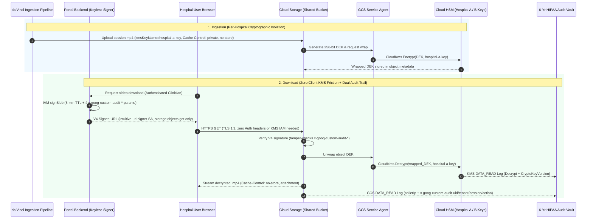

# HIPAA-Compliant Surgical Video Downloads on GCP (V4 Signed URLs + Per-Hospital Cloud HSM CMEK + Custom Audit)

End-to-end Google Cloud (Argolis) Proof of Concept for **direct-from-Cloud Storage surgical video downloads** using **keyless V4 Signed URLs**, **per-hospital Cloud HSM Customer-Managed Encryption Keys (CMEK)**, **`x-goog-custom-audit-*` tamper-proof user attribution**, an **instant per-hospital KMS Kill Switch**, and a **6-year HIPAA Dual Audit Vault**.

All components (`Cloud Storage`, `Cloud KMS / Cloud HSM`, `Cloud IAM`, `Identity Platform`, `Cloud Logging`) are **100% covered under Google Cloud's HIPAA BAA**.

---

## Architecture Overview



### Core HIPAA Security Controls

| HIPAA Guardrail | Implementation in This PoC |
| :--- | :--- |
| **Per-Hospital Cryptographic Isolation** | Shared regional bucket (`us-central1`) storing Hospital A (`hospital-a-stanford-key`) and Hospital B (`hospital-b-mayo-key`) videos under separate **FIPS 140-2 Level 3 Cloud HSM (`AES-256-GCM`)** keys via per-object `kmsKeyName`, backed by a bucket-level CMEK fallback key. |
| **Zero Client KMS Friction** | Only Google's internal GCS Service Agent (`service-<PROJECT_NUMBER>@gs-project-accounts.iam.gserviceaccount.com`) holds `roles/cloudkms.cryptoKeyEncrypterDecrypter`. Neither the URL-signing Service Account nor hospital end users hold any KMS permissions. |
| **Keyless V4 Signed URLs (5-Min TTL)** | Minted via IAM Credentials API (`iam.serviceAccounts.signBlob`)—zero static Service Account JSON keys (`iam.disableServiceAccountKeyCreation` compliant). Uses custom role `intuitiveSignedUrlObjectGetter` holding strictly `storage.objects.get` (cannot even list objects). |
| **Anti-Caching Enforcement** | Object metadata sets `Cache-Control: private, no-store`, and GCS natively enforces `Cache-Control: no-cache, no-store, max-age=0, must-revalidate` + `Content-Disposition: attachment` on V4 Signed URL responses. |
| **Tamper-Proof Clinician Attribution** | Embeds 4 signed query tags (`x-goog-custom-audit-uid`, `x-goog-custom-audit-tenant`, `x-goog-custom-audit-session`, `x-goog-custom-audit-action`) inside the V4 `CanonicalQueryString`. Mutating any tag invalidates `X-Goog-Signature` (`403 SignatureDoesNotMatch`). |
| **Instant Per-Hospital Kill Switch** | Disabling a hospital's KMS key version revokes already-issued, unexpired V4 Signed URLs (`HTTP 400 CloudKmsDisabledKey`), while other hospitals' videos in the **same bucket** continue downloading (`200 OK`). |
| **Dual Audit Trail + 6-Year Vault** | Enables `DATA_READ`, `DATA_WRITE`, and `ADMIN_READ` on both `storage.googleapis.com` and `cloudkms.googleapis.com`, routing logs via `hipaa-gcs-kms-dual-audit-sink` into a `2,190`-day (6-year) regional Cloud Logging bucket (`hipaa-6yr-audit-vault`). |

---

## Repository Structure

```text
.
├── setup-argolis-sandbox.sh                  # Idempotent 7-step Argolis setup & E2E verification wizard
├── terraform/
│   ├── versions.tf                           # Bootstrap + project-scoped Google providers
│   ├── variables.tf                          # Configurable org/folder, billing, region & 6-yr lock toggle
│   ├── project.tf                            # Creates PoC project + enables Storage, KMS, IAM & Logging APIs
│   ├── kms.tf                                # Cloud HSM KeyRing + Stanford, Mayo & fallback CryptoKeys + GCS SA IAM
│   ├── storage.tf                            # Shared HIPAA GCS bucket (UBLA=true, PAP=enforced, versioning=true)
│   ├── iam.tf                                # Keyless intuitive-url-signer SA + custom storage.objects.get role
│   ├── audit_logging.tf                      # GCS & KMS DATA_READ audit configs + 2,190-day regional log vault
│   ├── outputs.tf                            # Exports resource IDs consumed automatically by Python scripts
│   ├── terraform.tfvars.template             # Sterilized template rendered by setup-argolis-sandbox.sh
│   └── tests/hipaa_guardrails.tftest.hcl     # Offline Terraform unit tests asserting HIPAA guardrails
└── scripts/
    ├── requirements.txt                      # Python SDK dependencies
    ├── hipaa_video_service.py                # CMEK upload, keyless signBlob V4 URL minter, KMS toggle & log reader
    ├── e2e_verify.py                         # Automated 6-stage live Argolis compliance verification suite
    └── portal_demo.py                        # Local web portal (http://127.0.0.1:8080) for browser testing
```

---

## Step-by-Step Setup & Replication Guide

### Prerequisites
- Access to a **Google Cloud Argolis** organization as `admin@<your-domain>.altostrat.com`
- `gcloud` CLI, `terraform` (`>= 1.7.0`), and `python3` (`>= 3.10`)
  *(On Google Corp macOS, `setup-argolis-sandbox.sh` automatically discovers `~/google-cloud-sdk/bin/gcloud`, `/Library/GoogleCorpSupport/Python/3.11/bin/python3`, and `gpkg` for Santa Lockdown compatibility).*

### Option A: One-Command Automated Setup & E2E Test (Recommended)

Clone the repository and run the interactive wizard:

```bash
git clone https://github.com/praswanthp-alt/int-vid-poc.git
cd int-vid-poc
./setup-argolis-sandbox.sh
```

What the wizard executes automatically (safe to re-run anytime):
1. **Step 1/7 — Pre-Flight & Smart ReAuth:** Validates `gcloud`, `terraform`, and `python3`; prompts `gcloud auth login` + `gcloud auth application-default login` if tokens are expired.
2. **Step 2/7 — Argolis Bootstrap:** Discovers your Organization ID and open Billing Account, ensures Org IAM bootstrap roles, creates/reuses an isolated `intuitive-hipaa-sandbox` folder, and configures the caller ADC quota project.
3. **Step 3/7 — Template Rendering:** Renders `terraform/terraform.tfvars` from `terraform/terraform.tfvars.template` (caching settings locally in gitignored `.argolis-config.env`).
4. **Step 4/7 — Offline Unit Tests:** Runs `terraform test` (`3 passed, 0 failed`) before touching cloud state.
5. **Step 5/7 — Infrastructure Provisioning:** Runs `terraform init`, `terraform plan`, and `terraform apply` (~90s on first run).
6. **Step 6/7 — Live 6-Stage End-to-End Verification:** Executes `scripts/e2e_verify.py` against the deployed Argolis project.
7. **Step 7/7 — Interactive Browser Demo:** Optionally launches `http://127.0.0.1:8080` so you can click `.mp4` downloads in Chrome/Safari and toggle hospital KMS keys live.

### Helper Commands

```bash
./setup-argolis-sandbox.sh --auto       # Non-interactive build + E2E test (once gcloud is logged in)
./setup-argolis-sandbox.sh --test-only  # Re-run offline Terraform unit tests + live 6-stage E2E suite
./setup-argolis-sandbox.sh --portal     # Launch local Browser Download Portal (http://127.0.0.1:8080)
./setup-argolis-sandbox.sh --destroy    # Tear down the deployed Argolis PoC project cleanly
./setup-argolis-sandbox.sh --sterilize  # Remove local state/config/venv files
```

### Option B: Manual Step-by-Step Execution

```bash
# 1. Authenticate with your Argolis admin account
gcloud auth login admin@<your-domain>.altostrat.com
gcloud auth application-default login

# 2. Configure & apply Terraform
cp terraform/terraform.tfvars.example terraform/terraform.tfvars
# Edit terraform/terraform.tfvars with your billing_account, org_id/folder_id, and operator_email
cd terraform
terraform init
terraform test
terraform apply
cd ..

# 3. Run the 6-stage live verification suite
python3 -m venv .venv
source .venv/bin/activate
pip install -r scripts/requirements.txt
python3 scripts/e2e_verify.py
```

---

## Verified End-to-End Test Results

### 1. Offline Terraform HIPAA Guardrail Unit Tests (`terraform test`)

```text
tests/hipaa_guardrails.tftest.hcl... in progress
  run "verify_hipaa_storage_and_cmek_guardrails"... pass
  run "verify_least_privilege_keyless_url_signer"... pass
  run "verify_dual_audit_logs_and_6yr_vault"... pass
tests/hipaa_guardrails.tftest.hcl... tearing down
tests/hipaa_guardrails.tftest.hcl... pass

Success! 3 passed, 0 failed.
```

### 2. Live 6-Stage Argolis Verification (`scripts/e2e_verify.py`)

```text
========================================================================================
[STEP 1/6] Ingest Surgical Videos with Per-Hospital CMEK Keys (Hospital A vs. Hospital B)
========================================================================================
  [PASS] Hospital A uploaded: sessions/hosp-stanford/davinci-sess-1001.mp4
         Encrypted with KEK : projects/<PROJECT_ID>/locations/us-central1/keyRings/davinci-hospital-cmek-ring/cryptoKeys/hospital-a-stanford-key/cryptoKeyVersions/1
         SHA-256            : da4991e52544892830cdff9a4f8117e1339940cc89c166c6cf5537212d342800
  [PASS] Hospital B uploaded: sessions/hosp-mayo/davinci-sess-2002.mp4
         Encrypted with KEK : projects/<PROJECT_ID>/locations/us-central1/keyRings/davinci-hospital-cmek-ring/cryptoKeys/hospital-b-mayo-key/cryptoKeyVersions/1
         SHA-256            : 55010b347c086b09f09c36e664b053c25c1c16e28d031b27116699fe83c0088a

========================================================================================
[STEP 2/6] Mint Keyless V4 Signed URLs (5-min TTL + 4 Signed x-goog-custom-audit-* Tags)
========================================================================================
  [PASS] Minted keyless V4 Signed URLs via IAM Credentials API (signBlob).
         Signer Principal : intuitive-url-signer@<PROJECT_ID>.iam.gserviceaccount.com
         TTL              : 300 seconds (5 min)
         Signed Audit Tags: uid, tenant, session, action

========================================================================================
[STEP 3/6] Verify Zero-Friction HTTPS Download & HIPAA Response Guardrails
========================================================================================
  [PASS] Hospital A Download -> HTTP 200 (47136 bytes, SHA-256 verified)
         Stored Metadata    : Cache-Control=private, no-store
         HTTP Cache-Control : no-cache, no-store, max-age=0, must-revalidate
         Content-Disposition: attachment; filename="davinci-sess-1001.mp4"
  [PASS] Hospital B Download -> HTTP 200 (45088 bytes, SHA-256 verified)

========================================================================================
[STEP 4/6] Test Tamper Resistance on x-goog-custom-audit-* Query Parameters
========================================================================================
  [PASS] Tampering with x-goog-custom-audit-uid rejected by GCS -> HTTP 403 (SignatureDoesNotMatch)

========================================================================================
[STEP 5/6] Test Per-Hospital KMS Kill Switch (Disable Hospital A Key While Signed URL Is Active)
========================================================================================
  Hospital A KMS Key Version 1 set to: DISABLED
  [PASS] Hospital A pre-minted V4 Signed URL revoked -> HTTP 400 (CloudKmsDisabledKey)
  [PASS] Tenant Isolation Confirmed: Hospital B's video in the SAME bucket still downloads cleanly -> HTTP 200
  Hospital A KMS Key Version 1 restored to: ENABLED
  [PASS] Hospital A V4 Signed URL recovered cleanly after KMS re-enablement -> HTTP 200

========================================================================================
[STEP 6/6] Verify Correlated Dual Audit Logs (GCS Custom Audit Tags + KMS Decrypt)
========================================================================================
  [PASS] GCS DATA_READ Audit Log Verified:
         Resource    : projects/_/buckets/<PROJECT_ID>-davinci-videos/objects/sessions/hosp-stanford/...
         Caller IP   : <CLIENT_IP>
         Custom Audit: {
           "x-goog-custom-audit-tenant": "hosp-stanford",
           "x-goog-custom-audit-session": "davinci-sess-1002-killswitch",
           "x-goog-custom-audit-uid": "uid_stanford_dr_smith_8821",
           "x-goog-custom-audit-action": "download"
         }
  [PASS] Correlated Cloud KMS Decrypt Audit Log Verified:
         KMS Key     : projects/<PROJECT_ID>/locations/us-central1/keyRings/.../cryptoKeys/hospital-a-stanford-key
         ServiceAgent: service-<PROJECT_NUMBER>@gs-project-accounts.iam.gserviceaccount.com

========================================================================================
ALL 6 HIPAA ARCHITECTURE CHECKS PASSED END-TO-END IN ARGOLIS!
========================================================================================
```

---

## Key Production Architecture Findings & Notes

1. **Pseudonymous IDs in `x-goog-custom-audit-*`:** Because V4 Signed URLs pass custom audit tags as signed query parameters (up to 4 keys; 64-char key, 1,200-char value), avoid embedding raw clinician emails or patient MRNs in URLs (which appear in browser history and corporate proxy logs). Use pseudonymous Identity Platform UIDs (`uid_...`) + session UUIDs as demonstrated here.
2. **GCS Built-in Anti-Caching on Signed URLs:** Setting `Cache-Control: private, no-store` on object metadata satisfies CSPM/posture scanners, while Google Cloud Storage's XML edge automatically serves `Cache-Control: no-cache, no-store, max-age=0, must-revalidate` + `Pragma: no-cache` on V4 Signed URL responses.
3. **KMS Kill Switch Propagation Window:** For cold objects at rest, disabling a hospital's Cloud HSM key version fails downloads in **`< 1 second` (`HTTP 400 CloudKmsDisabledKey`)**. If a key version was decrypted within the last minute, GCS's regional key-state cache expires within **`~60 seconds`**.
4. **Locking the 6-Year Audit Vault in Production:** In `terraform/variables.tf`, `lock_audit_bucket` defaults to `false` so Argolis test sandboxes can be cleanly torn down via `terraform destroy`. For production HIPAA deployments (45 CFR § 164.316(b)(2)(i)), set `lock_audit_bucket = true` to enforce irreversible WORM retention on `hipaa-6yr-audit-vault`.
